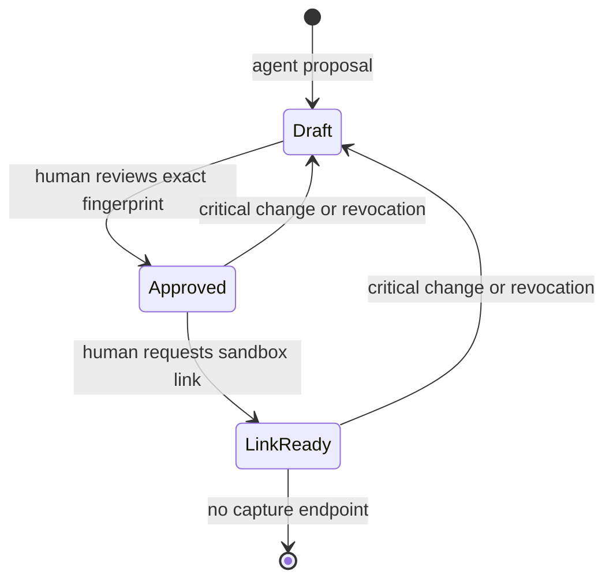

# Cart Consent

An AI shopping assistant can recommend a basket. It cannot approve one.

Cart Consent binds a human's approval to the exact products, quantities, catalog prices, currency, budget, shipping option, shipping charge, recipient address, merchant, and payment mode. Change one of those fields and the old approval stops working. The human must review the new fingerprint before a checkout link can be created.

This is a Python CLI and local JSON API for the [PayPal AI Hackathon](docs/competition.md). It uses a fictional stationery catalog. Default modes are fully local mocks: **no model inference, PayPal order, buyer checkout, authorization, or capture occurs**. Optional adapters use local Ollama and the official PayPal sandbox Orders API. There is no production or capture implementation.

## Run the consent demonstration

Python 3.10+; no third-party packages required. Run from the repository root:

```bash
python3 -m cart_consent --db /tmp/cart-consent-demo.sqlite3 demo
python3 scripts/verify.py
```

The demo uses a clearly labeled synthetic human to demonstrate: an unapproved link is blocked, an exact approval works, changing the postcode revokes it, and a new approval produces a new mock order. It is not evidence of real buyer consent or payment. Tests exercise the same rules over HTTP with separate agent/human credentials.



## Human review workflow

```bash
python3 -m cart_consent draft --input examples/cart.json --key my_private_draft_001
python3 -m cart_consent review --cart CART_ID
python3 -m cart_consent approve --cart CART_ID --fingerprint REVIEWED_FINGERPRINT
python3 -m cart_consent checkout-link --cart CART_ID --fingerprint REVIEWED_FINGERPRINT
```

Use the returned cart ID and the fingerprint shown by `review`. The approval lasts 15 minutes. Repeating the same approval does not extend it. An approved link request is idempotent; network retries use the same persisted `PayPal-Request-Id`. A catalog repricing, edit, revocation, or expiry during an upstream request withholds the resulting link.

Amounts are integer minor units, including shipping. Supported example currencies are USD, EUR, and GBP, all with two decimal places. The catalog owns item names/prices and shipping charges; an agent cannot submit its own prices. The example has zero tax and does not calculate real-world tax, stock, shipping eligibility, address validity, or foreign exchange.

`edit --cart CART_ID --input NEW_DRAFT.json --revision CURRENT_REVISION` performs an optimistic update. Even reducing a budget or changing an address field requires a new approval. Outer whitespace is normalized before fingerprinting. SHA256 identifies a snapshot; it is not a digital signature, AP2 mandate, or a payment authorization.

## Local JSON API and role separation

```bash
python3 -m cart_consent init-tokens
python3 -m cart_consent serve
```

`init-tokens` creates `var/roles.json` with two random tokens, permissions `0600`, and refuses to overwrite it. The server binds only to `127.0.0.1`. Keep the human token out of the agent runtime. Send a role token as `Authorization: Bearer TOKEN`; body fields cannot change the role.

| Endpoint | Capability |
| --- | --- |
| `GET /health` | Public mode disclosure; no credentials or addresses |
| `GET /v1/catalog` | Agent/human: fictional catalog and shipping prices |
| `POST /v1/proposals` | Agent/human: `{goal, context}` → unapproved draft; requires `Idempotency-Key` |
| `POST /v1/carts` | Agent/human: `{draft}` → unapproved draft; requires `Idempotency-Key` |
| `GET /v1/carts/{id}` | Human sees the full review snapshot; agent sees a redacted address |
| `PATCH /v1/carts/{id}` | Agent/human: `{draft, expected_revision}`; a change revokes approval |
| `POST /v1/carts/{id}/approve` | Human only: `{expected_fingerprint}` |
| `POST /v1/carts/{id}/checkout-link` | Human only: `{expected_fingerprint}` and current approval |
| `POST /v1/carts/{id}/revoke` | Human only: `{}` |
| `GET /v1/carts/{id}/audit` | Human only: hashes, changed field names, and event times |

With both modes still `mock`, another terminal can run `python3 scripts/api_demo.py`. It deliberately switches between synthetic roles for evaluation and never contacts PayPal. Do not give that combined-role example to a deployed shopping agent.

The CLI assumes its local operator owns the private ledger; HTTP bearer credentials enforce the role boundary. This is a single-buyer local prototype, not a multi-tenant identity or fraud-prevention system. The SQLite ledger contains private addresses and checkout URLs; do not publish it. Audit records omit address values, tokens, provider response bodies, and checkout URLs.

## Real AI proposals, without payment authority

Configure an already installed, appropriately licensed local Ollama model:

```bash
CART_AGENT_MODE=ollama OLLAMA_MODEL=YOUR_INSTALLED_MODEL python3 -m cart_consent propose \
  --goal "Choose stationery for a small workshop" --context examples/context.json --key workshop_proposal_001
```

The adapter uses documented `/api/chat` structured output. Only a goal, catalog, budget, currency, and shipping amount are sent to the model. The structured `shipping.address` fields, role tokens, PayPal credentials, approval tools, and payment tools are omitted. The free-text `goal` is sent unchanged: do not put addresses, personal information, secrets, or other sensitive data in it. This adapter does not detect or redact sensitive content in arbitrary text. Output is restricted to known SKU/quantity selections and an explanation, then independently validated. Bad output or unavailable inference fails without falling back to fake AI. `ai_used=true` appears only for configured Ollama calls; mock selection explicitly reports `false`. The local-model HTTP transport ignores environment proxy settings so its configured loopback request stays direct; the PayPal sandbox transport retains normal environment proxy support.

On 2026-11-06, the production planner and HTTP transport were exercised with an
actual local CPU-only `qwen2.5:0.5b` model and fictional inputs. A short request
for one pen set returned in 21.350 seconds: 899 item + 499 shipping = 1,398 minor
units, below the 5,000 budget. The validated proposal was persisted only as
`DRAFT`, with no approval or payment provider call. The [public evidence](docs/evidence/local-model-20261106.json)
retains that raw response, an earlier rejected over-budget response outcome,
and both observed timeouts. One targeted request is not a shopping-quality
benchmark. Unit adapter tests still use doubles; they are distinct from the
subsequent real integration record below.

On 2026-11-10, a fresh local `qwen2.5:0.5b` proposal returned in **5.899 seconds**
and remained an unapproved `DRAFT`. The developer reviewed the exact fictional
snapshot: one pen set, USD 8.99 plus USD 4.99 shipping, total **USD 13.98** against
a USD 50.00 budget. An explicit local CLI approval then allowed the real PayPal
sandbox adapter to create one unpaid order with status **`PAYER_ACTION_REQUIRED`**.
The returned amount, items, shipping, merchant and snapshot identifiers passed
the existing strict checks without an adapter code change. An initial OAuth
HTTP 401 occurred before any Orders request; correcting duplicated private
configuration retained the same cart, fingerprint, approval nonce and persisted
request ID. See the [sanitized integration record](docs/evidence/sandbox-model-20261110.json).

This was a **developer-operated synthetic demonstration**, not authenticated
real-buyer consent. The returned approval link was not opened. There was no
buyer checkout, authorization, capture or production payment. The local run is
evidence of the AI-to-reviewed-sandbox-order path, not a model-quality benchmark
or independent certification. A subsequent guarded CLI call returned the cached
existing order with zero network calls; this checks local replay, not remote
PayPal idempotency. The [published demonstration](https://youtu.be/icz2WX1DXZ4) is now available
(138.8 seconds, November 10). It edits sanitized evidence cards together with an
actual mock-mode terminal shot; it is not a continuous recording. Final project
submission remains pending. The technical Devpost draft is saved and personal feedback has been supplied;
final review, the required agreement and Submit are still pending.

## PayPal sandbox adapter

See [sandbox configuration and contract](docs/paypal-sandbox.md). `CART_PAYMENT_MODE=paypal-sandbox` requires explicit sandbox credentials, merchant ID, and HTTPS return/cancel URLs. Missing configuration or any other payment mode fails closed. Changing merchant or mode requires a fresh cart and approval.

The adapter only exchanges OAuth credentials and creates sandbox orders after human approval. It validates the returned order representation and sandbox approval URL, never opens a browser, and does not implement confirm-payment-source, authorize, capture, refunds, or production calls. Tests do not contact PayPal.

**Local revocation cannot cancel a PayPal-hosted URL already disclosed to someone.** It blocks further retrieval and use through this application. Existing remote orders require separate merchant-side reconciliation. The app never captures any order, and no completed-payment or completed-purchase claim is made.

## Existing work and submission status

[Landscape comparison](docs/landscape.md) covers PayPal Agent Toolkit and Google's AP2 with pinned commits and licenses. Approval-bound checkout is established work; this is an independently implemented, smaller policy gate, not a protocol invention or a fork. It is distinct from paid-content delivery: its output is a reviewed shopping decision, with changes that invalidate consent.

[Competition notes](docs/competition.md) record eligibility, dates, required technologies, open-source rules, and outstanding submission materials. Event registration was verified on **2026-11-09**. The real model/sandbox run and [138.8-second public video](https://youtu.be/icz2WX1DXZ4) were completed on November 10. The technical Devpost draft is saved, including the overview, Story, technology tags, public repository/video and original gallery/cover. Personal feedback has been supplied; final review, the required agreement and Submit remain pending, with no formal project receipt. Registration and a successful local integration run are not a final submission receipt, prize eligibility guarantee or commercial security certification.

MIT License. No GitHub Actions workflow is included; verification is local and reproducible.
